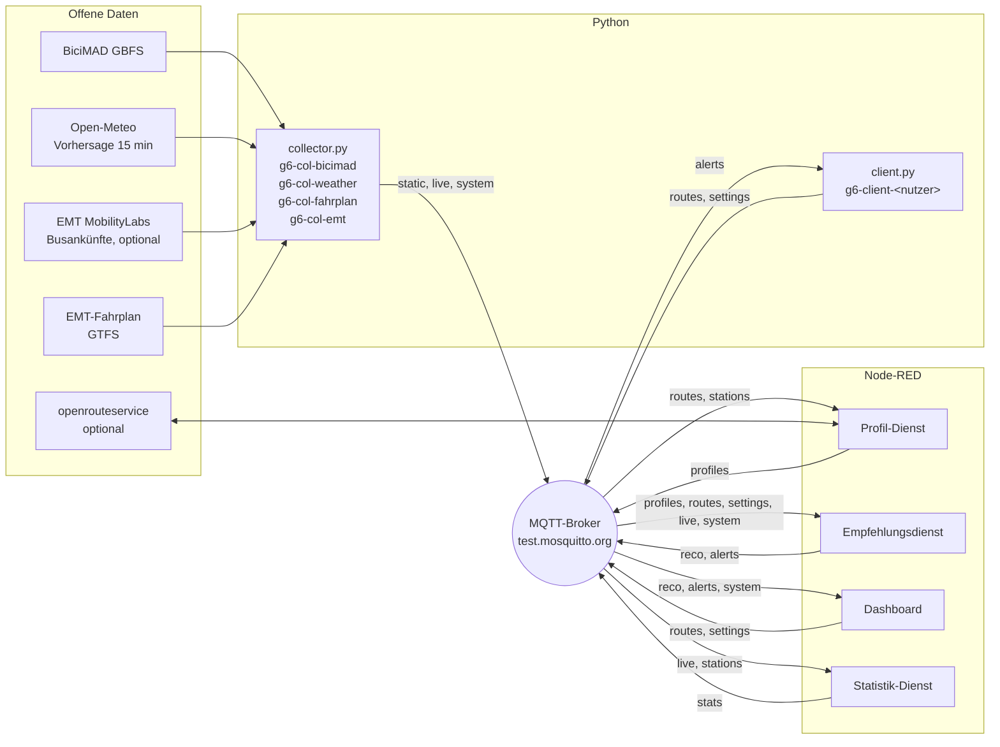

# MadridMove – Kann ich meine BiciMAD-Fahrt wie geplant machen?

Wer regelmäßig mit BiciMAD fährt, speichert seine Strecke: **Start- und Zielstation, Abfahrtszeit, Wochentage**. Vor jeder Fahrt meldet sich das System von selbst:

- **15 min vorher** ein kurzer Check: „✓ Rad passt: 7 Räder an Sol, trocken, 14 °C, ca. 22 min“
- eine **Warnung**, wenn etwas dagegen spricht: Regen, Wind oder Temperatur während der Fahrt über der **persönlichen Grenze**, keine Räder an der Startstation und im Umkreis, oder zu Fuß bzw. ÖPNV ist mindestens 5 min schneller. Mit Alternativen.
- eine **Entwarnung**, sobald es wieder passt.

Die BiciMAD-App zeigt nur, wie viele Räder gerade wo stehen. MadridMove bewertet *deine* Fahrt zur *richtigen* Zeit und schweigt, solange alles passt.

Kursprojekt Distributed Systems for IoT (UPM), Gruppe 6: Tobias Kleinkauf, Gabriel Ninos. Umgesetzt mit **MQTT**, **Python** (Producer und Consumer) und **Node-RED** (Verarbeitung und Dashboard).

---

## Architektur



**Python an den Rändern, Node-RED in der Mitte, MQTT verbindet alles.** Kein Dienst kennt einen anderen direkt: Jeder veröffentlicht und abonniert nur Topics.

| Teil | Sprache | Aufgabe |
|---|---|---|
| `python/collector.py` | Python | **Producer**: Stationen, Räder (nur Änderungen), Wetter mit Vorhersage, Busankünfte (EMT, optional) |
| `python/emt.py` | Python | Anmeldung bei EMT MobilityLabs, Token-Cache und automatische Erneuerung |
| `python/gtfs_plan.py` | Python | Fahrplan der EMT-Busse (GTFS): beste direkte Busverbindung je Route |
| `python/client.py` | Python | **Producer + Consumer**: Route und Einstellungen speichern, Meldungen empfangen |
| Profil-Dienst | Node-RED | Route → Fahrzeit, Fußweg, ÖPNV-Schätzung (mit ORS genauer) |
| Empfehlungsdienst | Node-RED | vorher „geplant“ (Vorschau), im Zeitfenster Rad ok oder Warnung und Meldungen |
| Statistik-Dienst | Node-RED | Kennzahlen für die Diagramme: Pendlerwelle, Zentrum gegen Stadtrand, Wetter und Radnutzung |
| Dashboard | Node-RED | Routenübersicht (Empfehlungen), Statistik (Diagramme), Routen verwalten (Formulare), Systemstatus, Demo |

## Topics (Präfix `upm-dsiot-g6/move`)

| Topic | Inhalt | QoS | Retained | Publisher |
|---|---|---|---|---|
| `static/stations` | Stationsliste (id, name, lat, lon, capacity) | 1 | ja | Collector |
| `live/bicimad/<station>` | `{bikes, docks, renting, returning, ts}`, nur bei Änderung, spätestens alle 10 min | 0 | ja | Collector |
| `live/weather` | aktuelles Wetter + Vorhersage für 24 h in 15-min-Schritten | 0 | ja | Collector |
| `live/emt/<nutzer>/<route>` | `{stop:{id,name,distM}, arrivals:[{line,destination,min}], ts}` nächste Busse am Startpunkt, alle 90 s | 0 | ja | Collector (nur mit EMT-Zugang) |
| `plan/<nutzer>/<route>` | beste direkte Busverbindung laut Fahrplan zur nächsten Abfahrt: Linie, Ein-/Ausstieg, Abfahrt oder Takt, Fahrzeit, Gesamtzeit; `status` ok / nodirect / noservice | 1 | ja | Collector |
| `stats/now` | freie Räder, leere/volle Stationen, Füllgrad Zentrum/Stadtrand | 0 | ja | Statistik-Dienst |
| `stats/spatial` | je Station `[km bis Sol, Füllgrad %]` | 0 | ja | Statistik-Dienst |
| `stats/history` | Verlauf: Pendlerwelle (5 min, 24 h), Radbewegungen + Wetter (10 min, 3 Tage) | 1 | ja | Statistik-Dienst |
| `routes/<nutzer>/<route>` | `{name, from:{id,label}, to:{id,label}, departure:{time, days}}`, leer = löschen | 1 | ja | Client / Dashboard |
| `users/<nutzer>/settings` | `{rain: kein/leicht/egal, windMax, tempMin, tempMax}` | 1 | ja | Client / Dashboard |
| `profiles/<nutzer>/<route>` | Fahrzeit, Höhenmeter, Fußweg, ÖPNV-Schätzung | 1 | ja | Profil-Dienst |
| `reco/<nutzer>/<route>` | Status geplant / ok / warn / unbekannt mit Gründen und Alternativen | 1 | ja | Empfehlungsdienst |
| `alerts/<nutzer>` | Vorab-Info, Warnung, Entwarnung (Text) | 1 | nein | Empfehlungsdienst |
| `system/<dienst>` | `online` / `offline (beendet)` / `offline (Absturz)` | 1 | ja | Birth / Close / **Last Will** |

**Last-Will-Topics:** `system/bicimad`, `system/weather`, `system/fahrplan` und `system/emt` (Collector, je eigene Verbindung), `system/client-<nutzer>` (Client). Bricht eine Verbindung ohne DISCONNECT ab, veröffentlicht der Broker „offline (Absturz)“ (retained). Beim sauberen Beenden senden die Programme vorher „offline (beendet)“, beim Start „online“ (Birth).

## Zustellsemantik

| Daten | QoS | Semantik | Begründung |
|---|---|---|---|
| Live-Daten (Räder, Wetter) | 0 | **at-most-once** | Ein verlorener Wert ist unkritisch, der nächste kommt in ≤ 1 min. Retained sorgt dafür, dass neue Abonnenten trotzdem sofort den letzten Stand haben. |
| Routen, Einstellungen, Profile, Status, Meldungen, Kommandos | 1 | **at-least-once** | Darf nicht verloren gehen. Duplikate sind harmlos: Routen und Status werden einfach überschrieben (idempotent), eine doppelte Meldung stört nicht. |
| Meldungen an den Client | 1 + persistente Session | **at-least-once**, auch offline | Der Client verbindet sich mit fester ID und `clean_session=False`. Der Broker hebt Meldungen auf, solange der Client aus ist. |
| – | 2 | exactly-once nicht nötig | QoS 2 kostet vier Nachrichten pro Zustellung und bringt hier nichts, weil keine Nachricht doppelt Schaden anrichtet. |

## Logik

Alle Werte stehen in Node-RED im Tab *⚙ Konfiguration* unter `reco`.

| Prüfung | Regel |
|---|---|
| Zeitfenster | Empfehlung erst 30 min vor der Abfahrt (`windowMin`). Vorher ist die Route **„geplant“**: Radfahrzeit, Wetter-Vorschau (sobald die Abfahrt in der 24-h-Vorhersage liegt), Busvergleich und „Empfehlung ab HH:MM“, aber kein Urteil und keine Räderzahl, weil Räder nur kurzfristig aussagekräftig sind. Würde das Wetter eine Grenze verletzen, steht das als Vorschau auf der Karte, ohne Meldung. |
| Wetter | Vorhersage für die Fahrt (Abfahrt bis Ankunft). Warnung, wenn die persönliche Grenze überschritten wird: Regen (kein Regen: ab 0,1 mm/15 min, leichter Regen ok: ab 1,0 mm), Wind über `windMax`, Temperatur außerhalb `tempMin`–`tempMax`. |
| Räder | Ab 3 Rädern ok. Weniger: Ausweichstation im Umkreis von 500 m mit ≥ 3 Rädern → nur Hinweis. Keine → Warnung. |
| Alternativen | Zu Fuß oder ÖPNV mindestens 5 min schneller → Warnung. In jeder Warnung stehen beide Alternativen. |
| ÖPNV | 1. **Fahrplan** (GTFS der EMT): beste direkte Buslinie von einer Haltestelle bis 600 m um den Start zu einer bis 600 m um das Ziel, zur geplanten Abfahrt. Zeit = Fußweg + Warten (bei Takt-Linien halber Takt) + Fahrzeit laut Plan + Fußweg. Fährt zu der Zeit kein direkter Bus (Wartezeit > 60 min), zählt ÖPNV nicht als Alternative. 2. **EMT live** (Abfahrt in ≤ 20 min): fährt die Fahrplan-Linie gerade an der Haltestelle, ersetzt die echte Wartezeit die geplante. 3. **Schätzung**, wenn es keine direkte Linie gibt (mit Umsteigen evtl. möglich): Wege + 4 min Warten + Strecke mit 18 km/h. |
| Zielstation voll | kein Thema, das Rad kann daneben abgestellt werden |
| Standardgrenzen | vorsichtig: kein Regen, Wind bis 25 km/h, 8–30 °C |
| Meldungen | nur im Zeitfenster: Warnung bei Wechsel auf „warn“ (auch beim Eintritt ins Fenster), Vorab-Info 15 min vorher, Entwarnung nur nach einer Warnung |
| Datenausfall | fehlen im Zeitfenster Stations- oder Wetterdaten, ist der Status „unbekannt“ und es gibt keine Meldung (sonst käme z. B. nach einem Absturz des Collectors eine falsche Entwarnung) |

---

## Einrichten und Starten

Voraussetzungen: Node-RED (bei uns im Docker-Container) mit `@flowfuse/node-red-dashboard` (Menü → Palette verwalten), Python 3.9+. Unter Windows heißt Python `py`, unter macOS/Linux `python3`.

```powershell
# 1. Einmalig (im Repo-Hauptordner)
cd "C:\...\madrid-move"
py -m pip install -r python\requirements.txt
py configure.py 6 tobias            # Entwickeln: eigenes Präfix. Vor dem Commit: py configure.py 6

# 2. Node-RED: http://localhost:1880 -> Menü -> Import -> flows/madridmove.json
#    -> "Ersetzen" bei Konflikten -> Deploy

# 3. Collector (Terminal 1, läuft dauerhaft)
cd python
py collector.py

# 4. Client (Terminal 2)
cd python
py client.py empfangen tobias
```

Dashboard: http://localhost:1880/dashboard. Blockiert das Netz Port 1883, den Handy-Hotspot nehmen.

### Fahrplan (automatisch)

Der Collector lädt beim Start den Busfahrplan der EMT (GTFS, ca. 236 Linien) nach `python/gtfs/transitemt.zip` und erneuert ihn wöchentlich; ein Konto ist nicht nötig. Klappt der Download nicht (Firewall, Port 8443), die Datei im Browser von https://servicios.emtmadrid.es:8443/gtfs/transitemt.zip laden und dort ablegen. Test ohne MQTT: `py gtfs_plan.py test 40.4169 -3.7035 40.4437 -3.7276 08:30` (Start, Ziel, Uhrzeit).

### EMT-Busankünfte (optional, dauerhaft)

1. `python/secrets.env.example` kopieren, Kopie `python/secrets.env` nennen.
2. Dort `EMT_EMAIL=` und `EMT_PASSWORD=` (Konto von mobilitylabs.emtmadrid.es) eintragen. Alternativ `EMT_CLIENT_ID=` und `EMT_PASSKEY=`.
3. Test: `cd python` und `py emt.py test` → „OK: Token vorhanden, noch 24.0 h gültig“.
4. `py collector.py` neu starten → im Log „EMT: angemeldet …“, im Dashboard ist „EMT-Bus“ grün.

`secrets.env` und der Token-Cache `.emt_token.json` stehen in `.gitignore` und landen nie im Repo. Das Passwort bleibt auf dem Rechner, der den Collector ausführt; über MQTT gehen nur Busankünfte. Der Token (ca. 24 h gültig) wird 30 min vor Ablauf und bei Ablehnung (Code 80) automatisch neu geholt. Ohne `secrets.env` läuft alles wie bisher mit der ÖPNV-Schätzung.

### Client

```bash
python3 client.py stationen sol                         # Stationsnummern finden
python3 client.py route-anlegen gabriel "Zur Uni" --start 1 --ziel 6 --zeit 08:30 --tage 1-5
python3 client.py einstellungen gabriel --regen leicht --wind 35 --temp 5 32
python3 client.py routen gabriel                        # Routen + aktueller Status
python3 client.py empfangen gabriel                     # Meldungen (persistente Session)
python3 client.py route-loeschen gabriel zur-uni
```

## Demo (ca. 4 min, nur echte Daten)

Bildschirm: links das Dashboard (*Routenübersicht*), rechts ein Terminal mit `python3 client.py empfangen demo` und daneben ein Mitleser (`mosquitto_sub` oder MQTT Explorer). Im Dashboard gibt es keine Popups: Das Dashboard zeigt den Zustand, die Meldungen gehen an den Client.

1. **Route anlegen**: auf *Routen verwalten* als Nutzer `demo` eine Route mit Abfahrt in ca. 12 min anlegen (oder auf *System & Demo* „Demo-Route anlegen“: Sol → Ciudad Universitaria, Abfahrt in 14 min, Standardgrenzen). Der Mitleser zeigt `routes/demo/…`, die Karte erscheint, der Client meldet „gespeichert … ✓ Rad passt“ und kurz danach die Vorab-Info.
2. **Personalisierung mit echtem Wetter**: unter *Meine Einstellungen* die Mindesttemperatur über die aktuelle Temperatur setzen → **Warnung** mit Alternativen (Bus laut Fahrplan, zu Fuß). Wieder zurücksetzen → **Entwarnung**.
3. **Last Will**: Collector-Fenster hart schließen (oder `kill -9`) → nach ca. 45 s „offline (Absturz)“, auf *Statistik* und *System & Demo* erscheint ein Hinweis.
4. Optional **persistente Session**: Client beenden, Einstellung ändern, Client neu starten → „(Session fortgesetzt)“, die verpasste Meldung kommt nach.

## Dashboard-Diagramme (Seite *Statistik*)

| Diagramm | Was es zeigt | Daten |
|---|---|---|
| Madrid jetzt | Wetter, freie Räder, leere/volle Stationen, Füllgrad, Radbewegungen, Status der Datenquellen (BiciMAD, Wetter, Fahrplan, EMT) | `stats/now`, `live/weather`, `system/+` |
| Pendlerwelle | Füllgrad (Räder ÷ Stellplätze) im Zentrum (≤ 3 km um Sol) und am Stadtrand über 24 h | ein Punkt alle 5 min |
| Zentrum gegen Stadtrand | jede Station: Entfernung zur Puerta del Sol gegen Füllgrad | jede Minute |
| Wetter und Radnutzung | Radbewegungen je 10 min (blau = Regen) und darunter Temperatur und Wind | alle 10 min, 3 Tage |

Der Verlauf liegt retained auf `stats/history` und wird nach einem Neustart von Node-RED übernommen. Die Diagramme füllen sich also nur, solange Collector und Node-RED laufen: für die Präsentation am besten ein paar Stunden vorher starten.

## Tests (für den Bericht)

| # | Test | Erwartet |
|---|---|---|
| 1 | Dashboard neu laden | sofort gefüllt (retained) |
| 2 | Route mit Abfahrt in 16 min anlegen | nach ca. 1 min Vorab-Info |
| 3 | Route mit Abfahrt in 2 h, Mindesttemperatur über aktuelle Temperatur setzen | Karte bleibt „geplant“ mit Vorschau „laut Vorhersage …“, **keine** Meldung; 30 min vor der Abfahrt kommt die Warnung |
| 4 | Collector mit Strg+C beenden | `system/bicimad` = „offline (beendet)“ |
| 5 | Collector hart beenden (`kill -9 <PID>`) | „offline (Absturz)“ (Last Will) |
| 6 | Client beenden, Einstellung ändern (Warnung auslösen), Client neu starten | „Session fortgesetzt“, verpasste Meldungen kommen nach |
| 7 | Zwei Nutzer mit derselben Route, nur einer mit enger Temperaturgrenze | Warnung nur für diesen Nutzer |
| 8 | Collector beenden und 15 min warten | Status „? Daten fehlen“, keine Meldung |

Alles mitlesen: `mosquitto_sub -h test.mosquitto.org -t 'upm-dsiot-g6/move/#' -v`

## Grenzen und Future Work

- ÖPNV: nur direkte Busverbindungen laut Fahrplan, keine Umstiege, keine Metro/Cercanías. Ohne direkte Linie bleibt es bei der Schätzung. Ausbau: Routing mit Umstiegen (z. B. Transitous) und die GTFS-Fahrpläne von Metro und Cercanías.
- Öffentlicher Broker ohne Anmeldung und Verschlüsselung: Jeder kann mitlesen und Routen ändern. In echt: eigener Broker mit TLS und Zugriffsrechten pro Nutzer (ACLs).
- Nutzer = Kurzname, keine Konten. Das Dashboard ist eine gemeinsame Übersicht; der persönliche Kanal ist der Client.
- Wetter für einen Punkt (Sol), nicht entlang der Strecke.

## Ordnerstruktur

```
flows/      madridmove.json (alle 5 Tabs: Konfiguration, Profil-Dienst, Empfehlung, Dashboard, Statistik)
python/     collector.py, client.py, emt.py, gtfs_plan.py, config.py, requirements.txt, secrets.env.example
            (secrets.env, .emt_token.json und gtfs/: nur lokal, git-ignoriert)
configure.py
```

## Änderungen an den Flows ins Repo übernehmen

Alle Tabs liegen in **einer** Datei. Nach Änderungen in Node-RED: Menü → *Export* → *Alle Flows* → herunterladen und `flows/madridmove.json` damit überschreiben, dann committen. Weil alles in einer Datei steht, sollte immer nur eine Person gleichzeitig an den Flows arbeiten (vorher `git pull`, danach sofort committen und pushen), sonst gibt es Merge-Konflikte.

## Datenquellen und Lizenzen

- BiciMAD GBFS (EMT Madrid / Ayuntamiento de Madrid, datos.gob.es)
- Open-Meteo, CC BY 4.0
- openrouteservice (HeiGIT), Kartendaten © OpenStreetMap-Mitwirkende (ODbL)
- EMT Madrid MobilityLabs (Busankünfte, Konto erforderlich)
- EMT GTFS (Busfahrplan), Portal de datos abiertos EMT / datos.madrid.es
