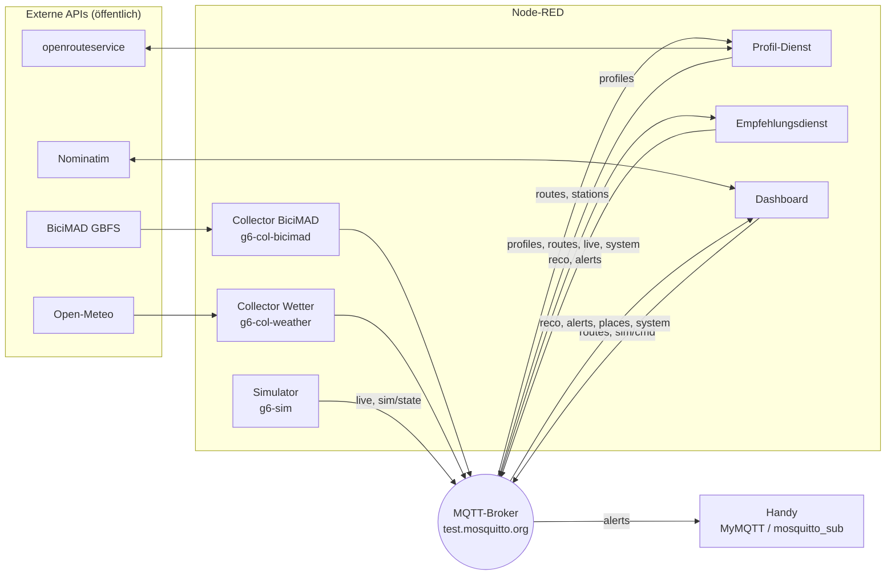

# MadridMove – Welches Verkehrsmittel lohnt sich gerade?

Jeder Nutzer speichert seine regelmäßigen Wege: Start und Ziel (feste Orte oder eine gesuchte Adresse) plus Abfahrtszeit und Wochentage. Das System prüft laufend, ob **BiciMAD**, **ÖPNV** oder **zu Fuß** gerade am sinnvollsten ist. Vor der Abfahrt meldet es sich von selbst aufs Handy: mit einer Vorab-Info und immer dann, wenn sich die Empfehlung ändert.

Grundlage sind Live-Daten (Räder und freie Plätze, Wetter) und ein Streckenprofil pro Route (Länge, Höhenmeter, Radweganteil). Umgesetzt mit **Node-RED** und **MQTT**. Kursprojekt DSIoT (UPM), Gruppe 6.

> Stand: Alle Flows sind mit nachgebauten APIs und dem eingebauten Simulator getestet (Node-RED 4.1, Dashboard 2.0 v1.37, lokaler Broker). Gegen die **echten** APIs müsst ihr noch prüfen, siehe [Was ihr noch prüfen müsst](#was-ihr-noch-prüfen-müsst).

---

## Architektur



Kein Dienst kennt einen anderen direkt, alle sprechen nur über Topics miteinander (Raum- und Zeitentkopplung). Jeder Collector und der Simulator haben eine **eigene Broker-Verbindung** mit Birth-, Close- und Last-Will-Nachricht. Fällt ein Collector aus, rechnet der Empfehlungsdienst ohne dessen Daten weiter und zeigt das an (Graceful Degradation). Der Simulator veröffentlicht auf **denselben Topics** wie die Collectors; die anderen Dienste merken keinen Unterschied.

### Topic-Baum (Präfix `upm-dsiot-g6/move`)

| Topic | Inhalt | QoS | Retained | Publisher |
|---|---|---|---|---|
| `…/static/stations` | Liste aller Stationen (id, name, lat, lon, capacity) | 1 | ja | Collector BiciMAD |
| `…/static/places` | Feste Orte für das Formular (id, cat, label, lat, lon) | 1 | ja | Konfiguration |
| `…/live/bicimad/<station-id>` | `{bikes, docks, renting, returning, ts}`, nur bei Änderung, spätestens alle 10 min | 0 | ja | Collector BiciMAD / Simulator |
| `…/live/weather` | `{temp, precip, wind, code, ts}` | 0 | ja | Collector Wetter / Simulator |
| `…/system/<dienst>` | `online` / `offline (beendet)` / `offline (Absturz)` für `bicimad`, `weather`, `sim` | 1 | ja | Birth / Close / Last Will |
| `…/routes/<nutzer>/<route>` | `{name, from:{label,lat,lon}, to:…, departure:{time, days}}`, leere Nachricht = löschen | 1 | ja | Dashboard / Handy |
| `…/profiles/<nutzer>/<route>` | Länge, Dauer, Höhenmeter, Radweganteil, Fußweg, ÖPNV-Schätzung | 1 | ja | Profil-Dienst |
| `…/reco/<nutzer>/<route>` | Empfehlung, alle Optionen mit Begründung, nächste Abfahrt, Zeitfenster | 1 | ja | Empfehlungsdienst |
| `…/alerts/<nutzer>` | Text: Route aktiv, Vorab-Info, Wechsel der Empfehlung | 1 | nein | Empfehlungsdienst |
| `…/sim/cmd` | `{scenario}`: Szenario starten oder `stop` | 1 | nein | Dashboard |
| `…/sim/state` | `{active, scenario, label, phase, startedAt}` | 1 | ja | Simulator |
| `…/cmd/bicimad/refresh`, `…/cmd/weather/refresh` | Collector soll sofort alles neu senden | 1 | nein | Simulator (beim Beenden) |

### Kurskonzepte im Projekt

| Konzept | Einsatz | Begründung |
|---|---|---|
| `+`-Wildcard | `routes/+/+`, `profiles/+/+`, `live/bicimad/+`, `system/+` | ein Abo für alle Nutzer, Routen, Stationen |
| `#`-Wildcard | `alerts/#`, Test-Subscriber `live/#` | alle Unterebenen mit einem Abo |
| Retained | Stationen, Orte, Live-Daten, Routen, Profile, Empfehlungen, Status, Simulationszustand | neue Clients sehen sofort den aktuellen Stand; **Routen und Profile sind auf dem Broker gespeichert** (keine Datenbank nötig) |
| Leere Retained-Nachricht | Route löschen | entfernt die gespeicherte Nachricht vom Broker; Profil und Empfehlung werden ebenso gelöscht |
| Last Will | je Collector und Simulator auf `system/<dienst>` | Absturz wird sichtbar statt still veralteter Daten |
| Birth / Close | dito | Unterschied zwischen sauberem Beenden und Absturz |
| Keep Alive 30 s | alle Verbindungen | Broker erkennt tote Verbindungen und löst den Last Will aus |
| QoS 0 | Live-Daten | ein verlorener Wert ist unkritisch, der nächste kommt bald |
| QoS 1 | Routen, Profile, Empfehlungen, Warnungen, Kommandos | dürfen nicht verloren gehen; Duplikate sind harmlos (idempotent) |
| Persistente Session | Handy mit `cleanSession=false` und fester Client-ID | verpasste Warnungen werden nachgeliefert |
| Decoupling | Dienste kennen sich nicht; Simulator ersetzt die Collectors ohne Änderung an anderen Diensten | Raum-, Zeit- und Synchronisationsentkopplung (L2) |
| Report by Exception | BiciMAD nur bei Änderung | statt ca. 600 Nachrichten pro Minute nur die geänderten |
| Caching über Retained | Profil-Dienst prüft vorhandene Profile | nach einem Neustart keine erneuten ORS-Anfragen |
| Kommando-Topics | `sim/cmd`, `cmd/…/refresh` | Steuerung über MQTT statt direkter Aufrufe zwischen Diensten |

---

## Empfehlungslogik

Für jede Route rechnet der Empfehlungsdienst drei Zeiten in Minuten aus und empfiehlt die schnellste **mögliche** Option („gefühlte Zeit“). Alle Werte stehen in der Konfiguration unter `reco`.

| Option | Grundzeit | Aufschläge | Nicht möglich, wenn |
|---|---|---|---|
| BiciMAD | Fußweg zur Station + Fahrt + 2 min Ausleihen/Abstellen + Fußweg vom Ziel | Regen +8 / stark +16, Wind ab 30 km/h +3, unter 3 °C oder über 35 °C +3, 3 s je Höhenmeter (E-Bike), Radweg bis −3, **knapp** (1–2 Räder) +3 | 0 Räder am Start, nächste Station über 1 km, BiciMAD-Daten fehlen oder älter als 15 min |
| ÖPNV (Schätzung) | 8 min Wege + 4 min Warten + Strecke mit 18 km/h | keine | nie |
| Zu Fuß | Gehzeit | Regen +5 / stark +10, Hitze/Kälte +3 | nie |

- **Ziel voll:** nur ein Hinweis („Rad mit Schloss neben der Station abstellen“), kein Ausschluss.
- **Mindestvorsprung:** Die Empfehlung wechselt nur, wenn eine andere Option mindestens 2 min schneller ist, oder wenn die bisherige gar nicht mehr möglich ist. So springt sie nicht hin und her.
- **Zeitfenster:** Meldungen gibt es nur in den 30 min vor der Abfahrt. Das Dashboard zeigt die Empfehlung immer.
- **Vorab-Info:** 15 min vor der Abfahrt einmal pro Fahrt („Abfahrt in 15 min. Heute: BiciMAD · 17 min“).
- **Datenausfall:** Fehlen BiciMAD- oder Wetterdaten, bleibt die bisherige Empfehlung stehen (mit Hinweis). Ist sie ohne die Daten nicht mehr möglich, wird ohne Meldung gewechselt.

---

## Ordnerstruktur

```
madrid-move/
├── flows/
│   ├── 00-konfiguration.json   # APIs, Parameter, feste Orte, Broker-Verbindungen
│   ├── 10-collector.json       # BiciMAD + Wetter
│   ├── 20-profil-dienst.json   # Routen -> Streckenprofil (ORS)
│   ├── 30-empfehlung.json      # Empfehlung + Meldungen
│   ├── 40-dashboard.json       # 3 Dashboard-Seiten
│   └── 50-simulation.json      # Simulator mit Szenarien
├── configure.py                # setzt Gruppennummer in Präfix und Client-IDs
├── .gitignore
└── README.md
```

## Node-RED-Tabs und Rollen

| Tab | Rolle | Inhalt |
|---|---|---|
| ⚙ Konfiguration | gemeinsam | **alle API-URLs, Parameter und festen Orte an einer Stelle** (Function „Konfiguration“ → Reiter *Beim Start*); veröffentlicht die Orte |
| Collector | A | BiciMAD (Stationsliste, Status), Wetter, eigene Broker-Verbindungen mit Last Will; pausiert während einer Simulation |
| Profil-Dienst | B | Routen → ORS (Fahrrad + Fuß) → Profil; Schätzmodus ohne Schlüssel |
| Empfehlung | A | Empfehlungslogik, Zeitfenster, Meldungen |
| Dashboard | B | 3 Seiten: Empfehlungen (Routenkarten), Routen verwalten, System & Demo |
| Simulation | gemeinsam | Szenarien für Vorführung und Tests |

---

## Einrichten

### 1. Node-RED starten (wie Praxis-Lektion 1)

Dashboard 2.0 braucht **Node-RED 3.0 oder neuer** (Version steht unten links im Menü → *Über*).

- **VM / Mac:** Terminal → `node-red`
- **Docker:**
  ```bash
  docker run -it -p 1880:1880 -v node_red_data:/data --name mynodered \
    -e ORS_API_KEY=DEIN_SCHLÜSSEL nodered/node-red
  ```
  Umgebungsvariablen lassen sich nur beim **Anlegen** eines Containers setzen. Habt ihr `mynodered` schon, löscht ihn mit `docker rm mynodered` und legt ihn neu an. Eure Flows bleiben im Volume erhalten.

### 2. Dashboard-Paket installieren

Menü (☰) → *Palette verwalten* → *Installieren* → `@flowfuse/node-red-dashboard`

### 3. Gruppennummer setzen

```bash
python3 configure.py 6              # Abgabe / Demo
python3 configure.py 6 gabriel      # beim Entwickeln: eigener Bereich pro Person
```

**Wichtig:** Laufen zwei Node-RED-Instanzen mit derselben Konfiguration gleichzeitig am öffentlichen Broker, werfen sie sich gegenseitig raus (gleiche Client-IDs) und senden doppelte Daten. Entwickelt deshalb jeweils mit eurem Kürzel. Für die Demo nehmt ihr die Variante ohne Kürzel und lasst sie auf **einem** Rechner laufen.

### 4. Flows importieren

Menü → *Import* → *Datei zum Import auswählen* → nacheinander alle sechs Dateien aus `flows/` → *Importieren* → **Deploy**. Sind die Tabs schon da, fragt Node-RED nach vorhandenen Nodes: **„Ersetzen“** wählen.

### 5. ORS-Schlüssel (optional, aber empfohlen)

Ohne Schlüssel läuft alles im **Schätzmodus**: Strecke aus Luftlinie × 1,3, keine Höhenmeter, kein Radweganteil.

1. Kostenlos registrieren auf https://openrouteservice.org/dev/#/signup und einen *Standard*-Token anlegen.
2. Schlüssel als Umgebungsvariable setzen:
   - VM / Mac: `ORS_API_KEY=DEIN_SCHLÜSSEL node-red`
   - Docker: siehe Schritt 1 (`-e ORS_API_KEY=…`)
3. Der Status unter der Function **Konfiguration** zeigt „ORS-Schlüssel gesetzt“.

**Den Schlüssel nie in Flows oder ins Repo schreiben.** Das Repo ist für die Abgabe sichtbar.

### 6. Ausprobieren

- Dashboard: http://localhost:1880/dashboard
- Seite *System & Demo* → **Demo-Routen anlegen**: drei Routen für den Nutzer `demo`, Abfahrt in 14 min (sofort „aktiv“)
- Gleiche Seite → **Demo-Ablauf starten**: Simulation von 3 min, siehe unten
- Seite *Routen verwalten*: eigene Route anlegen (Name, Routenname, Start, Ziel, Abfahrtszeit, Wochentage). Start und Ziel aus der Liste wählen (tippen filtert) oder vorher rechts eine Adresse suchen.
- Handy (MyMQTT): Broker `test.mosquitto.org`, Port 1883, abonnieren:
  - `upm-dsiot-g6/move/alerts/<dein-name>`
  - `upm-dsiot-g6/move/system/+`

Blockiert das Uni-WLAN Port 1883, den Handy-Hotspot nehmen.

---

## Simulation

Der Simulator (Tab *Simulation*) erzeugt realistische Live-Daten, damit ihr jede Situation vorführen und testen könnt, ohne auf echten Regen oder leere Stationen zu warten. Gestartet wird auf der Seite *System & Demo*.

- Simuliert werden die Start- und Zielstationen aller Routen und je 4 Nachbarstationen. Ausgangswerte sind die letzten echten Werte.
- Während einer Simulation pausieren die Collectors ihre Live-Werte (sie lesen `…/sim/state`). **Simulation beenden** schickt `refresh` an die Collectors, die dann sofort wieder echte Werte senden.
- Simulierte Werte tragen `demo: true`; Dashboard und Karten zeigen „Simulation“.
- Ohne Internet (keine Stationsliste vom Collector) legt der Simulator Ersatzstationen „SIM …“ neben den festen Orten an. So funktioniert die Vorführung notfalls auch offline mit einem lokalen Broker.

| Szenario | Ablauf | Was man sieht |
|---|---|---|
| Demo-Ablauf (3 min) | 0 s trocken · 20 s Startstationen knapp (2 Räder) · 50 s leichter Regen · 80 s starker Regen · 130 s Regen vorbei, Umverteilung bringt Räder | Karte „knapp“, Wechsel zu ÖPNV mit Meldung, Wechsel zurück zu BiciMAD mit Meldung |
| Regenschauer | 20 s leicht · 60 s stark · 150 s nachlassend · 200 s trocken | Wechsel zu ÖPNV und zurück |
| Startstation leert sich | 15 s knapp · 75 s leer · 150 s Umverteilung (+10 Räder) | „knapp“, dann „keine Räder“, dann wieder BiciMAD |
| Hitzetag | 38 °C | Aufschlag für Fahrrad und Fußweg |
| Sturm | 48 km/h Wind, 0,4 mm Regen | Aufschlag Wind + Regen |
| Normaler Werktag | trocken, 16 °C, Räder schwanken leicht | Ausgangslage |

---

## Was ihr noch prüfen müsst

Die Flows sind gegen nachgebaute API-Antworten getestet. Gleicht beim ersten echten Lauf ab, ob die echten Antworten genauso aussehen. Wo nötig, ändert ihr den Code in den genannten Function-Nodes.

Tipp: Hängt einen **debug-Node** (Ausgabe: *vollständiges Nachrichtenobjekt*) direkt hinter den jeweiligen http-request-Node.

### A. BiciMAD GBFS (Tab *Collector*)

1. Im Browser öffnen: https://madrid.publicbikesystem.net/customer/gbfs/v2/gbfs.json
   - [ ] Lädt die Datei ohne Schlüssel?
   - [ ] Gibt es unter `data → es` oder `data → en` die Feeds `station_information` und `station_status`?
2. Nach dem Deploy: Status unter **Feeds finden** = „Feeds gefunden“, unter **Stationsliste** = „N Stationen“ (ca. 600), unter **Status publizieren** = „N/N gesendet“.
3. Feldnamen prüfen (Function **Stationsliste**: `station_id, name, lat, lon, capacity`; Function **Status publizieren**: `num_bikes_available, num_docks_available, is_renting, is_returning`).

### B. Open-Meteo (Tab *Collector*)

1. Im Browser öffnen:
   https://api.open-meteo.com/v1/forecast?latitude=40.4168&longitude=-3.7038&current=temperature_2m,precipitation,wind_speed_10m,weather_code&timezone=Europe%2FMadrid
   - [ ] Gibt es `current.temperature_2m`, `current.precipitation`, `current.wind_speed_10m`?
2. Status unter **Wetter publizieren** zeigt Temperatur, Regen und Wind.

### C. openrouteservice (Tab *Profil-Dienst*)

1. Schlüssel testen:
   ```bash
   curl -X POST https://api.openrouteservice.org/v2/directions/cycling-regular \
     -H "Authorization: DEIN_SCHLÜSSEL" -H "Content-Type: application/json" \
     -d '{"coordinates":[[-3.7035,40.4169],[-3.7190,40.4352]],"elevation":true,"extra_info":["waytype","steepness"],"instructions":false}'
   ```
2. In der Antwort prüfen (Function **Fahrrad auswerten**):
   - [ ] `routes[0].summary.distance` (m) und `routes[0].summary.duration` (s)
   - [ ] `ascent`/`descent`: liegen sie in `routes[0].summary` oder direkt in `routes[0]`? Der Code prüft beides.
   - [ ] `routes[0].extras.waytype.summary`: Liste mit `value` und `amount` (%). `value: 6` = Radweg (Cycleway).
   - [ ] `routes[0].extras.steepness.summary`: `value` 3–5 = steil (ab 7 %).
3. Im Profil (`…/profiles/<nutzer>/<route>`) muss `"source": "openrouteservice"` stehen. Steht dort `Schätzung`, enthält `orsError` die Fehlermeldung.

### D. Adresssuche (Tab *Dashboard*, Nominatim)

1. Seite *Routen verwalten* → rechts „Calle de Alcalá 50“ suchen.
   - [ ] Erscheinen bis zu 5 Treffer mit 🔎 oben in den Listen Start und Ziel?
2. Funktioniert sie nicht (z. B. gesperrt), bleiben die festen Orte nutzbar.

### E. Feste Orte und Parameter (Tab *⚙ Konfiguration*)

- Die Koordinaten der festen Orte sind auf ca. 100 m genau. Prüft vor allem eure Demo-Orte und ob dort eine BiciMAD-Station in der Nähe liegt.
- Die Gewichte unter `reco` sind begründete Startwerte, keine Messwerte (z. B. 8 min Regenaufschlag fürs Fahrrad, ÖPNV mit 18 km/h plus 8 min Wege plus 4 min Warten). Prüft sie an euren echten Wegen und begründet sie im Bericht.

---

## Tests (für den Bericht, je ein Screenshot)

| # | Test | Vorgehen | Erwartetes Ergebnis |
|---|---|---|---|
| 1 | Retained | Dashboard neu laden | Karten und Tabellen sofort gefüllt |
| 2 | Route anlegen | Formular auf *Routen verwalten* | Popup und Handy: „Route … ist aktiv: aktuell …“ |
| 3 | Adresssuche | Adresse suchen, Treffer als Start wählen | Treffer mit 🔎 in der Liste, Route mit dieser Adresse |
| 4 | Vorab-Info | Route mit Abfahrt in 16 min anlegen, 1–2 min warten | Handy: „Abfahrt in 15 min. Heute: …“ |
| 5 | Zeitfenster | Route mit Abfahrt in 2 h anlegen, *Regenschauer* starten | Karte wechselt, **keine** Meldung (außerhalb des Fensters) |
| 6 | Empfehlungswechsel (Regen) | Demo-Routen, *Regenschauer* | Handy: „jetzt ÖPNV … statt BiciMAD (Regen)“ und später zurück |
| 7 | Knapp / leer | *Startstation leert sich* | Karte „knapp“, dann „keine Räder an …“, dann zurück |
| 8 | Mindestvorsprung | Demo-Ablauf, Phase 2 (knapp, +3 min) | Empfehlung bleibt BiciMAD, keine Meldung |
| 9 | Kein Spam | Szenario zweimal starten | nur eine Meldung pro Wechsel |
| 10 | Simulation beenden | *Simulation beenden* | Collectors senden echte Werte, „Simulation“-Hinweis verschwindet |
| 11 | Route löschen | *Route löschen* | Karte verschwindet; `…/routes`, `…/profiles`, `…/reco` der Route sind leer |
| 12 | Last Will | Node-RED hart beenden: `kill -9 <PID>` bzw. `docker kill mynodered` | Handy: `system/bicimad`, `system/weather`, `system/sim` = „offline (Absturz)“, nach ca. 45 s (1,5 × Keep Alive) |
| 13 | Close-Nachricht | Strg+C bzw. `docker stop mynodered` | „offline (beendet)“, kein Last Will |
| 14 | Birth | Node-RED neu starten | „online“ |
| 15 | Graceful Degradation | Im Tab *Collector* den mqtt-out-Node „g6-col-weather“ deaktivieren → Deploy | Status „offline (beendet)“, Karten mit Hinweis „ohne Wetterdaten“, keine Wechsel-Meldung deswegen |
| 16 | Caching | Node-RED neu starten | Status *Routen-Eingang*: „unverändert: …“, keine neuen ORS-Anfragen |
| 17 | Persistente Session | siehe unten | verpasste Warnung kommt nach |
| 18 | Wildcards | Debug-Node „Live-Daten“ im Tab *Collector* aktivieren | alle Stationen und Wetter, keine Warnungen |
| 19 | Schätzmodus | ohne `ORS_API_KEY` starten | Profil `source: Schätzung (Luftlinie)`, Hinweis in den Details |

**Persistente Session (Test 17)** mit `mosquitto_sub` wie in Praxis-Lektion 3:

```bash
# -c = keine Clean Session, -i = feste Client-ID, -q 1 = QoS 1
mosquitto_sub -h test.mosquitto.org -t 'upm-dsiot-g6/move/alerts/#' -q 1 -c -i g6-handy -v
```

Ablauf: Subscriber starten → mit Strg+C beenden → *Regenschauer* starten → Subscriber mit derselben Client-ID neu starten → die verpasste Warnung kommt nach.

Alles mitlesen (praktisch beim Entwickeln):

```bash
mosquitto_sub -h test.mosquitto.org -t 'upm-dsiot-g6/move/#' -v
```

---

## Live-Demo (ca. 5 Minuten)

Vorher: Hotspot statt Uni-WLAN, Node-RED läuft seit ein paar Minuten, Handy hat `alerts/demo` abonniert, MQTT Explorer neben dem Dashboard.

1. **Demo-Routen anlegen**: drei Karten erscheinen, Handy zeigt „Route … ist aktiv“. Dashboard neu laden: sofort gefüllt (Retained).
2. **Demo-Ablauf starten** und erzählen, was passiert:
   - Startstationen werden knapp → Karte „knapp“, Empfehlung bleibt (Mindestvorsprung).
   - Regen setzt ein → Empfehlung wechselt zu ÖPNV, Meldung aufs Handy (QoS 1).
   - Regen vorbei, Umverteilung → zurück zu BiciMAD, Meldung.
3. Im MQTT Explorer zeigen: Der Simulator schreibt auf dieselben Topics wie die Collectors (Entkopplung).
4. Wetter-Collector deaktivieren: Empfehlung läuft weiter „ohne Wetterdaten“ (Graceful Degradation).
5. `kill -9` bzw. `docker kill`: Handy zeigt „offline (Absturz)“ (Last Will). Neu starten: „online“ (Birth).
6. Persistente Session mit `mosquitto_sub -c` vorführen.

---

## Zusammenarbeit mit Git

- Jede Person arbeitet nur in **ihren** Tabs (siehe Rollen).
- Nach Änderungen: Menü → *Export* → *Aktueller Flow* → die passende Datei in `flows/` überschreiben, dann committen. So entstehen keine Merge-Konflikte.
- Vor jedem Arbeiten: `git pull`.

## Grenzen (für den Bericht)

- Öffentlicher Broker ohne Authentifizierung und Verschlüsselung: Jeder kann mitlesen und Routen anlegen oder löschen. In Tests und Demo deshalb nur öffentliche Orte, keine Wohnadressen. In echt: eigener Broker mit TLS und Zugriffsrechten pro Nutzer (ACLs).
- Nutzer = selbstgewählter Kurzname, keine Konten.
- Das Dashboard ist für alle Browser gleich (eine gemeinsame Übersicht). Der persönliche Kanal ist das Handy-Abo auf `alerts/<nutzer>`.
- ÖPNV-Zeiten sind Schätzungen (kein Fahrplan-Routing). Ausbau: EMT-MobilityLabs-API für Live-Wartezeiten an der nächsten Bushaltestelle.
- Es zählt das aktuelle Wetter, nicht die Vorhersage für die Abfahrtszeit.
- Radwegdaten aus OpenStreetMap (über ORS), nicht aus dem offiziellen Datensatz der Stadt.

## Datenquellen und Lizenzen

- BiciMAD GBFS, EMT Madrid / Ayuntamiento de Madrid, Datensatz auf datos.gob.es: Nutzungsbedingungen im Bericht zitieren.
- Open-Meteo: Daten unter CC BY 4.0, Quellenangabe erforderlich, nicht-kommerziell kostenlos.
- openrouteservice (HeiGIT), Kartendaten © OpenStreetMap-Mitwirkende (ODbL).
- Nominatim (Adresssuche): © OpenStreetMap-Mitwirkende (ODbL), Nutzungsregeln: höchstens 1 Anfrage pro Sekunde, keine Autovervollständigung.
