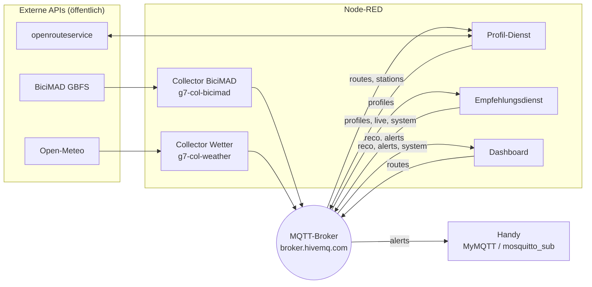

# MadridMove – Welches Verkehrsmittel lohnt sich gerade?

Jeder Nutzer legt eigene Routen zwischen zwei BiciMAD-Stationen an. Das System prüft laufend, ob **BiciMAD**, **ÖPNV** oder **zu Fuß** gerade am sinnvollsten ist, und schickt eine Nachricht aufs Handy, wenn sich die Empfehlung ändert.

Grundlage sind Live-Daten (Räder und freie Plätze, Wetter) und ein Streckenprofil pro Route (Länge, Höhenmeter, Radweganteil). Umgesetzt mit **Node-RED** und **MQTT**. Kursprojekt DSIoT (UPM).

> Prototyp-Stand: Alle Flows sind mit simulierten APIs getestet (Node-RED 5.0, Dashboard 2.0 v1.37, lokaler Broker). Gegen die **echten** APIs müsst ihr noch prüfen, siehe [Was ihr noch prüfen müsst](#was-ihr-noch-prüfen-müsst).

---

## Architektur



Kein Dienst kennt einen anderen direkt, alle sprechen nur über Topics miteinander (Raum- und Zeitentkopplung). Jeder Collector hat eine **eigene Broker-Verbindung** mit Birth-, Close- und Last-Will-Nachricht. Fällt ein Collector aus, rechnet der Empfehlungsdienst ohne dessen Daten weiter und zeigt das an (Graceful Degradation).

### Topic-Baum (Präfix `upm-dsiot-g7/move`)

| Topic | Inhalt | QoS | Retained | Publisher |
|---|---|---|---|---|
| `…/static/stations` | Liste aller Stationen (id, name, lat, lon, capacity) | 1 | ja | Collector BiciMAD |
| `…/live/bicimad/<station-id>` | `{bikes, docks, renting, returning, ts}`, nur bei Änderung, spätestens alle 10 min | 0 | ja | Collector BiciMAD |
| `…/live/weather` | `{temp, precip, wind, code, ts}` | 0 | ja | Collector Wetter |
| `…/system/<collector>` | `online` / `offline (beendet)` / `offline (Absturz)` | 1 | ja | Birth / Close / Last Will |
| `…/routes/<nutzer>/<route>` | `{name, from:{id}|{lat,lon}, to:…}`, leere Nachricht = löschen | 1 | ja | Dashboard / Handy |
| `…/profiles/<nutzer>/<route>` | Länge, Dauer, Höhenmeter, Radweganteil, Fußweg, ÖPNV-Schätzung | 1 | ja | Profil-Dienst |
| `…/reco/<nutzer>/<route>` | Empfehlung mit allen Optionen und Begründungen | 1 | ja | Empfehlungsdienst |
| `…/alerts/<nutzer>` | Text, wenn sich die Empfehlung ändert | 1 | nein | Empfehlungsdienst |
| `…/cmd/bicimad/refresh`, `…/cmd/weather/refresh` | Collector soll sofort neu senden (Demo) | 1 | nein | Dashboard |

### Kurskonzepte im Projekt

| Konzept | Einsatz | Begründung |
|---|---|---|
| `+`-Wildcard | `routes/+/+`, `profiles/+/+`, `live/bicimad/+`, `system/+` | ein Abo für alle Nutzer, Routen, Stationen |
| `#`-Wildcard | `alerts/#`, Test-Subscriber `live/#` | alle Unterebenen mit einem Abo |
| Retained | Stationen, Live-Daten, Routen, Profile, Empfehlungen, Status | neue Clients sehen sofort den aktuellen Stand; **Routen und Profile sind auf dem Broker gespeichert** (keine Datenbank nötig) |
| Leere Retained-Nachricht | Route löschen | entfernt die gespeicherte Nachricht vom Broker; Profil und Empfehlung werden ebenso gelöscht |
| Last Will | je Collector auf `system/<collector>` | Absturz wird sichtbar statt still veralteter Daten |
| Birth / Close | dito | Unterschied zwischen sauberem Beenden und Absturz |
| Keep Alive 30 s | alle Verbindungen | Broker erkennt tote Verbindungen und löst den Last Will aus |
| QoS 0 | Live-Daten | ein verlorener Wert ist unkritisch, der nächste kommt bald |
| QoS 1 | Routen, Profile, Empfehlungen, Warnungen | dürfen nicht verloren gehen; Duplikate sind harmlos (idempotent) |
| Persistente Session | Handy mit `cleanSession=false` und fester Client-ID | verpasste Warnungen werden nachgeliefert |
| Decoupling | Dienste kennen sich nicht | Raum-, Zeit- und Synchronisationsentkopplung (L2) |
| Report by Exception | BiciMAD nur bei Änderung | statt ca. 600 Nachrichten pro Minute nur die geänderten |
| Caching über Retained | Profil-Dienst prüft vorhandene Profile | nach einem Neustart keine erneuten ORS-Anfragen |

---

## Ordnerstruktur

```
madridmove/
├── flows/madridmove.json   # alle Flows (5 Tabs) zum Importieren
├── configure.py            # setzt Gruppennummer in Präfix und Client-IDs
├── report/                 # Bericht, Screenshots
├── .gitignore
└── README.md
```

## Node-RED-Tabs und Rollen

| Tab | Rolle | Inhalt |
|---|---|---|
| ⚙ Konfiguration | gemeinsam | **alle API-URLs und Parameter an einer Stelle** (Function „Konfiguration“ → Reiter *Beim Start*) |
| Collector | A | BiciMAD (Stationsliste, Status), Wetter, eigene Broker-Verbindungen mit Last Will |
| Profil-Dienst | B | Routen → ORS (Fahrrad + Fuß) → Profil; Schätzmodus ohne Schlüssel |
| Empfehlung | A | Empfehlungslogik, Warnungen |
| Dashboard | B | 3 Seiten: Empfehlungen, Routen verwalten, System & Demo |

---

## Einrichten

### 1. Node-RED starten (wie Praxis-Lektion 1)

Dashboard 2.0 braucht **Node-RED 3.0 oder neuer** (Version steht unten links im Menü → *Über*).

- **VM:** Terminal → `node-red`
- **Docker:**
  ```bash
  docker run -it -p 1880:1880 -v node_red_data:/data --name mynodered \
    -e ORS_API_KEY=DEIN_SCHLÜSSEL nodered/node-red
  ```
  Umgebungsvariablen lassen sich nur beim **Anlegen** eines Containers setzen. Habt ihr `mynodered` schon, löscht ihn mit `docker rm mynodered` und legt ihn neu an. Eure Flows bleiben im Volume erhalten.

### 2. Dashboard-Paket installieren

Menü (☰) → *Palette verwalten* → *Installieren* → `@flowfuse/node-red-dashboard`

### 3. Gruppennummer setzen

```bash
python configure.py 12            # eure Gruppennummer
python configure.py 12 tobias     # beim Entwickeln: eigener Bereich pro Person
```

**Wichtig:** Laufen zwei Node-RED-Instanzen mit derselben Konfiguration gleichzeitig am öffentlichen Broker, werfen sie sich gegenseitig raus (gleiche Client-IDs) und senden doppelte Daten. Entwickelt deshalb jeweils mit eurem Kürzel. Für die Demo nehmt ihr die Variante ohne Kürzel und lasst sie auf **einem** Rechner laufen.

### 4. Flows importieren

Menü → *Import* → *Datei zum Import auswählen* → `flows/madridmove.json` → *Importieren* → **Deploy**.

### 5. ORS-Schlüssel (optional, aber empfohlen)

Ohne Schlüssel läuft alles im **Schätzmodus**: Strecke aus Luftlinie × 1,3, keine Höhenmeter, kein Radweganteil.

1. Kostenlos registrieren auf https://openrouteservice.org/dev/#/signup und einen *Standard*-Token anlegen (2.000 Routen pro Tag).
2. Schlüssel als Umgebungsvariable setzen:
   - VM: `ORS_API_KEY=DEIN_SCHLÜSSEL node-red`
   - Docker: siehe Schritt 1 (`-e ORS_API_KEY=…`)
3. Der Status unter der Function **Konfiguration** zeigt „ORS-Schlüssel gesetzt“.

**Den Schlüssel nie in Flows oder ins Repo schreiben.** Das Repo ist für die Abgabe sichtbar.

### 6. Ausprobieren

- Dashboard: http://localhost:1880/dashboard
- Seite *System & Demo* → **Demo-Routen anlegen**: drei Routen für den Nutzer `demo`
- Seite *Routen verwalten*: eigene Route anlegen (Name, Routenname, Start, Ziel)
- Handy (MyMQTT): Broker `broker.hivemq.com`, Port 1883, abonnieren:
  - `upm-dsiot-gXX/move/alerts/<dein-name>`
  - `upm-dsiot-gXX/move/system/+`

---

## Was ihr noch prüfen müsst

Die Flows sind gegen nachgebaute API-Antworten getestet. Gleicht beim ersten echten Lauf ab, ob die echten Antworten genauso aussehen. Wo nötig, ändert ihr den Code in den genannten Function-Nodes.

Tipp: Hängt einen **debug-Node** (Ausgabe: *vollständiges Nachrichtenobjekt*) direkt hinter den jeweiligen http-request-Node.

### A. BiciMAD GBFS (Tab *Collector*)

1. Im Browser öffnen: https://madrid.publicbikesystem.net/customer/gbfs/v2/gbfs.json
   - [ ] Lädt die Datei ohne Schlüssel?
   - [ ] Gibt es unter `data → es` oder `data → en` die Feeds `station_information` und `station_status`?
2. Nach dem Deploy: Status unter **Feeds finden** = „Feeds gefunden“, unter **Stationsliste** = „N Stationen“ (ca. 600), unter **Status publizieren** = „N/N gesendet“.
3. Feldnamen prüfen (Function **Stationsliste**: `station_id, name, lat, lon, capacity`; Function **Status publizieren**: `num_bikes_available, num_docks_available, is_renting, is_returning`).
4. Lädt die Datei nicht: Plan B ist die EMT-MobilityLabs-API (kostenlose Registrierung). Dann ändert ihr nur `apis.gbfs` in der Konfiguration und die beiden Functions.

### B. Open-Meteo (Tab *Collector*)

1. Im Browser öffnen:
   https://api.open-meteo.com/v1/forecast?latitude=40.4168&longitude=-3.7038&current=temperature_2m,precipitation,wind_speed_10m,weather_code&timezone=Europe%2FMadrid
   - [ ] Gibt es `current.temperature_2m`, `current.precipitation`, `current.wind_speed_10m`?
2. Status unter **Wetter publizieren** zeigt Temperatur, Regen und Wind.

### C. openrouteservice (Tab *Profil-Dienst*)

1. Schlüssel testen (Terminal oder Git Bash):
   ```bash
   curl -X POST https://api.openrouteservice.org/v2/directions/cycling-regular \
     -H "Authorization: DEIN_SCHLÜSSEL" -H "Content-Type: application/json" \
     -d '{"coordinates":[[-3.7035,40.4169],[-3.7190,40.4352]],"elevation":true,"extra_info":["waytype","steepness"],"instructions":false}'
   ```
2. In der Antwort prüfen (Function **Fahrrad auswerten**):
   - [ ] `routes[0].summary.distance` (m) und `routes[0].summary.duration` (s)
   - [ ] `ascent`/`descent`: liegen sie in `routes[0].summary` oder direkt in `routes[0]`? Der Code prüft beides.
   - [ ] `routes[0].extras.waytype.summary`: Liste mit `value` und `amount` (%). `value: 6` = Radweg (Cycleway).
   - [ ] `routes[0].extras.steepness.summary`: `value` 3–5 = steil (ab 7 %).
3. Im Profil (`…/profiles/<nutzer>/<route>`) muss `"source": "openrouteservice"` stehen. Steht dort `Schätzung`, enthält `orsError` die Fehlermeldung.

### D. Parameter der Empfehlung (Tab *⚙ Konfiguration*)

Die Gewichte unter `reco` sind begründete Startwerte, keine Messwerte. Zum Beispiel: 9 s Aufschlag pro Höhenmeter, 8 min Regenaufschlag fürs Fahrrad, ÖPNV mit 18 km/h plus 8 min Fußweg plus 4 min Warten. Prüft sie an euren echten Wegen in Madrid und begründet sie im Bericht.

---

## Tests (für den Bericht, je ein Screenshot)

| # | Test | Vorgehen | Erwartetes Ergebnis |
|---|---|---|---|
| 1 | Retained | Dashboard neu laden | Tabellen sofort gefüllt |
| 2 | Route anlegen | Formular auf *Routen verwalten* | Popup und Handy: „Route … ist aktiv: aktuell …“ |
| 3 | Empfehlungswechsel (Regen) | *Starkregen simulieren* | Handy: „jetzt ÖPNV … statt BiciMAD (starker Regen)“ |
| 4 | Empfehlungswechsel (Station leer) | *Startstationen leer simulieren* | Fahrrad „nicht möglich“, Begründung „keine Räder an …“ |
| 5 | Kein Spam | Demo-Schalter zweimal drücken | nur eine Warnung |
| 6 | Demo beenden | *Demo beenden* | Collectors senden echte Werte, Empfehlung zurück |
| 7 | Route löschen | *Route löschen* | Zeile verschwindet; `…/routes`, `…/profiles`, `…/reco` der Route sind leer |
| 8 | Last Will | Node-RED hart beenden: VM `kill -9 <PID>` (PID per `ps aux \| grep node-red`), Docker `docker kill mynodered` | Handy: `system/bicimad` und `system/weather` = „offline (Absturz)“, spätestens nach ca. 45 s (1,5 × Keep Alive) |
| 9 | Close-Nachricht | VM Strg+C, Docker `docker stop mynodered` | „offline (beendet)“, kein Last Will |
| 10 | Birth | Node-RED neu starten | „online“ |
| 11 | Graceful Degradation | Im Tab *Collector* den mqtt-out-Node „g7-col-weather“ deaktivieren → Deploy | Status „offline (beendet)“, Empfehlungen mit Hinweis „ohne Wetterdaten“ |
| 12 | Caching | Node-RED neu starten | Status *Routen-Eingang*: „unverändert: …“, keine neuen ORS-Anfragen |
| 13 | Persistente Session | siehe unten | verpasste Warnung kommt nach |
| 14 | Wildcards | Debug-Node „Live-Daten“ im Tab *Collector* aktivieren | alle Stationen und Wetter, keine Warnungen |
| 15 | Schätzmodus | ohne `ORS_API_KEY` starten | Profil `source: Schätzung (Luftlinie)`, Hinweis in der Tabelle |

**Persistente Session (Test 13)** mit `mosquitto_sub` wie in Praxis-Lektion 3:

```bash
# -c = keine Clean Session, -i = feste Client-ID, -q 1 = QoS 1
mosquitto_sub -h broker.hivemq.com -t 'upm-dsiot-gXX/move/alerts/#' -q 1 -c -i gXX-handy -v
```

Ablauf: Subscriber starten → mit Strg+C beenden → Demo-Schalter „Starkregen“ → Subscriber mit derselben Client-ID neu starten → die verpasste Warnung kommt nach.

Alles mitlesen (praktisch beim Entwickeln):

```bash
mosquitto_sub -h broker.hivemq.com -t 'upm-dsiot-gXX/move/#' -v
```

---

## Live-Demo (ca. 5 Minuten)

1. Dashboard zeigen: Empfehlungen, Status „online“, Wetter.
2. Dashboard neu laden: sofort gefüllt (Retained).
3. Neue Route im Formular anlegen: Handy zeigt „Route … ist aktiv“.
4. *Starkregen simulieren*: Empfehlung wechselt, Warnung auf dem Handy (QoS 1).
5. Wetter-Collector deaktivieren: Empfehlung läuft weiter „ohne Wetterdaten“ (Entkopplung).
6. `kill -9` bzw. `docker kill`: Handy zeigt „offline (Absturz)“ (Last Will). Neu starten: „online“ (Birth).
7. Persistente Session mit `mosquitto_sub -c` vorführen.

---

## Zusammenarbeit mit Git

- Jede Person arbeitet nur in **ihren** Tabs (siehe Rollen).
- Nach Änderungen: Menü → *Export* → *Aktueller Flow* → als `flows/<tab>.json` speichern (z. B. `flows/collector.json`), dann committen. So entstehen keine Merge-Konflikte.
- Vor der Abgabe: Menü → *Export* → *Alle Flows* → `flows/madridmove.json` aktualisieren.
- Vor jedem Arbeiten: `git pull`.

## Grenzen (für den Bericht)

- Öffentlicher Broker ohne Authentifizierung: Jeder kann mitlesen und Routen anlegen. Deshalb nur Stationen, keine Wohnadressen.
- Nutzer = selbstgewählter Kurzname, keine Konten.
- Das Dashboard ist für alle Browser gleich (eine gemeinsame Übersicht). Der persönliche Kanal ist das Handy-Abo auf `alerts/<nutzer>`.
- ÖPNV-Zeiten sind Schätzungen (kein Fahrplan-Routing). Ausbau: EMT-MobilityLabs-API für Live-Wartezeiten an der nächsten Bushaltestelle.
- Radwegdaten aus OpenStreetMap (über ORS), nicht aus dem offiziellen Datensatz der Stadt.

## Datenquellen und Lizenzen

- BiciMAD GBFS, EMT Madrid / Ayuntamiento de Madrid, Datensatz auf datos.gob.es: Nutzungsbedingungen im Bericht zitieren.
- Open-Meteo: Daten unter CC BY 4.0, Quellenangabe erforderlich, nicht-kommerziell kostenlos.
- openrouteservice (HeiGIT), Kartendaten © OpenStreetMap-Mitwirkende (ODbL).
