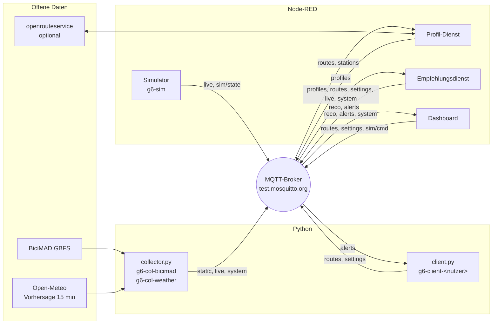

# MadridMove – Kann ich meine BiciMAD-Fahrt wie geplant machen?

Wer regelmäßig mit BiciMAD fährt, speichert seine Strecke: **Start- und Zielstation, Abfahrtszeit, Wochentage**. Vor jeder Fahrt meldet sich das System von selbst:

- **15 min vorher** ein kurzer Check: „✓ Rad passt: 7 Räder an Sol, trocken, 14 °C, ca. 22 min“
- eine **Warnung**, wenn etwas dagegen spricht: Regen, Wind oder Temperatur während der Fahrt über der **persönlichen Grenze**, keine Räder an der Startstation und im Umkreis, oder zu Fuß bzw. ÖPNV ist mindestens 5 min schneller. Mit Alternativen.
- eine **Entwarnung**, sobald es wieder passt.

Die BiciMAD-App zeigt nur, wie viele Räder gerade wo stehen. MadridMove bewertet *deine* Fahrt zur *richtigen* Zeit und schweigt, solange alles passt.

Kursprojekt Distributed Systems for IoT (UPM), Gruppe 6: Tobias Kleinkauf, Gabriel Ninos. Umgesetzt mit **MQTT**, **Python** (Producer und Consumer) und **Node-RED** (Verarbeitung und Dashboard).

---

## Architektur



**Python an den Rändern, Node-RED in der Mitte, MQTT verbindet alles.** Kein Dienst kennt einen anderen direkt. Der Simulator veröffentlicht für die Vorführung auf denselben Topics wie der Collector, und die übrigen Dienste merken keinen Unterschied.

| Teil | Sprache | Aufgabe |
|---|---|---|
| `python/collector.py` | Python | **Producer**: Stationen, Räder (nur Änderungen), Wetter mit Vorhersage |
| `python/client.py` | Python | **Producer + Consumer**: Route und Einstellungen speichern, Meldungen empfangen |
| Profil-Dienst | Node-RED | Route → Fahrzeit, Fußweg, ÖPNV-Schätzung (mit ORS genauer) |
| Empfehlungsdienst | Node-RED | Rad ok oder Warnung, Meldungen im Zeitfenster |
| Dashboard | Node-RED | Übersicht, Formulare, Systemstatus, Demo |
| Simulator | Node-RED | fester Demo-Ablauf für die Vorführung |

## Topics (Präfix `upm-dsiot-g6/move`)

| Topic | Inhalt | QoS | Retained | Publisher |
|---|---|---|---|---|
| `static/stations` | Stationsliste (id, name, lat, lon, capacity) | 1 | ja | Collector |
| `live/bicimad/<station>` | `{bikes, docks, renting, returning, ts}`, nur bei Änderung, spätestens alle 10 min | 0 | ja | Collector / Simulator |
| `live/weather` | aktuelles Wetter + Vorhersage für 24 h in 15-min-Schritten | 0 | ja | Collector / Simulator |
| `routes/<nutzer>/<route>` | `{name, from:{id,label}, to:{id,label}, departure:{time, days}}`, leer = löschen | 1 | ja | Client / Dashboard |
| `users/<nutzer>/settings` | `{rain: kein/leicht/egal, windMax, tempMin, tempMax}` | 1 | ja | Client / Dashboard |
| `profiles/<nutzer>/<route>` | Fahrzeit, Höhenmeter, Fußweg, ÖPNV-Schätzung | 1 | ja | Profil-Dienst |
| `reco/<nutzer>/<route>` | Status ok / warn / unbekannt mit Gründen und Alternativen | 1 | ja | Empfehlungsdienst |
| `alerts/<nutzer>` | Vorab-Info, Warnung, Entwarnung (Text) | 1 | nein | Empfehlungsdienst |
| `system/<dienst>` | `online` / `offline (beendet)` / `offline (Absturz)` | 1 | ja | Birth / Close / **Last Will** |
| `sim/cmd`, `sim/state` | Demo starten/beenden, Zustand | 1 | nein / ja | Dashboard / Simulator |
| `cmd/bicimad/refresh`, `cmd/weather/refresh` | Collector soll sofort alles neu senden | 1 | nein | Simulator |

**Last-Will-Topics:** `system/bicimad` und `system/weather` (Collector, je eigene Verbindung), `system/sim` (Simulator), `system/client-<nutzer>` (Client). Bricht eine Verbindung ohne DISCONNECT ab, veröffentlicht der Broker „offline (Absturz)“ (retained). Beim sauberen Beenden senden die Programme vorher „offline (beendet)“, beim Start „online“ (Birth).

## Zustellsemantik

| Daten | QoS | Semantik | Begründung |
|---|---|---|---|
| Live-Daten (Räder, Wetter) | 0 | **at-most-once** | Ein verlorener Wert ist unkritisch, der nächste kommt in ≤ 1 min. Retained sorgt dafür, dass neue Abonnenten trotzdem sofort den letzten Stand haben. |
| Routen, Einstellungen, Profile, Status, Meldungen, Kommandos | 1 | **at-least-once** | Darf nicht verloren gehen. Duplikate sind harmlos: Routen und Status werden einfach überschrieben (idempotent), eine doppelte Meldung stört nicht. |
| Meldungen an den Client | 1 + persistente Session | **at-least-once**, auch offline | Der Client verbindet sich mit fester ID und `clean_session=False`. Der Broker hebt Meldungen auf, solange der Client aus ist. |
| – | 2 | exactly-once nicht nötig | QoS 2 kostet vier Nachrichten pro Zustellung und bringt hier nichts, weil keine Nachricht doppelt Schaden anrichtet. |

## Logik

Alle Werte stehen in Node-RED im Tab *⚙ Konfiguration* unter `reco`.

| Prüfung | Regel |
|---|---|
| Wetter | Vorhersage für die Fahrt (Abfahrt bis Ankunft). Warnung, wenn die persönliche Grenze überschritten wird: Regen (kein Regen: ab 0,1 mm/15 min, leichter Regen ok: ab 1,0 mm), Wind über `windMax`, Temperatur außerhalb `tempMin`–`tempMax`. |
| Räder | Ab 3 Rädern ok. Weniger: Ausweichstation im Umkreis von 500 m mit ≥ 3 Rädern → nur Hinweis. Keine → Warnung. |
| Alternativen | Zu Fuß oder ÖPNV (Schätzung) mindestens 5 min schneller → Warnung. In jeder Warnung stehen beide Alternativen. |
| Zielstation voll | kein Thema, das Rad kann daneben abgestellt werden |
| Standardgrenzen | vorsichtig: kein Regen, Wind bis 25 km/h, 8–30 °C |
| Meldungen | nur 30 min vor der Abfahrt: Warnung bei Wechsel auf „warn“, Vorab-Info 15 min vorher, Entwarnung nur nach einer Warnung |
| Datenausfall | fehlen Stationsdaten, ist der Status „unbekannt“ und es gibt keine Meldung; fehlt das Wetter, wird ohne Wetter bewertet (mit Hinweis) |

---

## Einrichten und Starten

Voraussetzungen: Node.js mit Node-RED, das Paket `@flowfuse/node-red-dashboard` (Menü → Palette verwalten), Python 3.9+.

```bash
# 1. Einmalig
cd madrid-move
python3 -m pip install -r python/requirements.txt
python3 configure.py 6              # Abgabe/Demo; zum Entwickeln: python3 configure.py 6 <kürzel>

# 2. Node-RED (Terminal 1)
node-red                            # optional: ORS_API_KEY=... node-red
#    http://localhost:1880 -> Import -> alle Dateien aus flows/ -> Deploy

# 3. Collector (Terminal 2)
cd python && python3 collector.py

# 4. Client (Terminal 3)
cd python && python3 client.py empfangen gabriel
```

Dashboard: http://localhost:1880/dashboard. Blockiert das Netz Port 1883, den Handy-Hotspot nehmen.

### Client

```bash
python3 client.py stationen sol                         # Stationsnummern finden
python3 client.py route-anlegen gabriel "Zur Uni" --start 1 --ziel 6 --zeit 08:30 --tage 1-5
python3 client.py einstellungen gabriel --regen leicht --wind 35 --temp 5 32
python3 client.py routen gabriel                        # Routen + aktueller Status
python3 client.py empfangen gabriel                     # Meldungen (persistente Session)
python3 client.py route-loeschen gabriel zur-uni
```

## Demo (ca. 3 min, Seite *System & Demo*)

1. **Demo-Routen anlegen**: zwei Routen für den Nutzer `demo`, Abfahrt in 14 min. Client mit `python3 client.py empfangen demo` zeigt sofort „gespeichert … ✓ Rad passt“.
2. **Demo-Ablauf starten**:

| Zeit | Simulation | Ergebnis |
|---|---|---|
| 0 s | alles gut | Karten „✓ Rad passt“ |
| 20 s | Startstationen fast leer, Nachbarn haben Räder | nur Hinweis „Ausweichstation … (70 m)“, **keine** Meldung |
| 60 s | Regen in der Vorhersage | **Warnung** mit Alternativen auf dem Client |
| 120 s | Regen vorbei, Räder aufgefüllt | **Entwarnung** |

3. **Simulation beenden**: der Collector sendet sofort wieder echte Werte.
4. Für Last Will und Persistent Session siehe Tests 4–6.

## Tests (für den Bericht)

| # | Test | Erwartet |
|---|---|---|
| 1 | Dashboard neu laden | sofort gefüllt (retained) |
| 2 | Route mit Abfahrt in 16 min anlegen | nach ca. 1 min Vorab-Info |
| 3 | Route mit Abfahrt in 2 h, Demo-Ablauf | Karte wechselt, **keine** Meldung (außerhalb des Zeitfensters) |
| 4 | Collector mit Strg+C beenden | `system/bicimad` = „offline (beendet)“ |
| 5 | Collector hart beenden (`kill -9 <PID>`) | „offline (Absturz)“ (Last Will) |
| 6 | Client beenden, Demo-Ablauf, Client neu starten | „Session fortgesetzt“, verpasste Meldungen kommen nach |
| 7 | Einstellungen auf „Regen egal“, Demo-Ablauf | keine Regen-Warnung für diesen Nutzer |
| 8 | Collector beenden und 15 min warten | Status „? Daten fehlen“, keine Meldung |

Alles mitlesen: `mosquitto_sub -h test.mosquitto.org -t 'upm-dsiot-g6/move/#' -v`

## Grenzen und Future Work

- ÖPNV-Zeiten sind eine Schätzung (Wege + Warten + Strecke mit 18 km/h). Ausbau: echte Verbindungen über einen ÖPNV-Routingdienst (z. B. Transitous) oder EMT-Wartezeiten.
- Öffentlicher Broker ohne Anmeldung und Verschlüsselung: Jeder kann mitlesen und Routen ändern. In echt: eigener Broker mit TLS und Zugriffsrechten pro Nutzer (ACLs).
- Nutzer = Kurzname, keine Konten. Das Dashboard ist eine gemeinsame Übersicht; der persönliche Kanal ist der Client.
- Wetter für einen Punkt (Sol), nicht entlang der Strecke.

## Ordnerstruktur

```
flows/      00-konfiguration, 20-profil-dienst, 30-empfehlung, 40-dashboard, 50-simulation
python/     collector.py, client.py, config.py, requirements.txt
configure.py
```

## Datenquellen und Lizenzen

- BiciMAD GBFS (EMT Madrid / Ayuntamiento de Madrid, datos.gob.es)
- Open-Meteo, CC BY 4.0
- openrouteservice (HeiGIT), Kartendaten © OpenStreetMap-Mitwirkende (ODbL)
