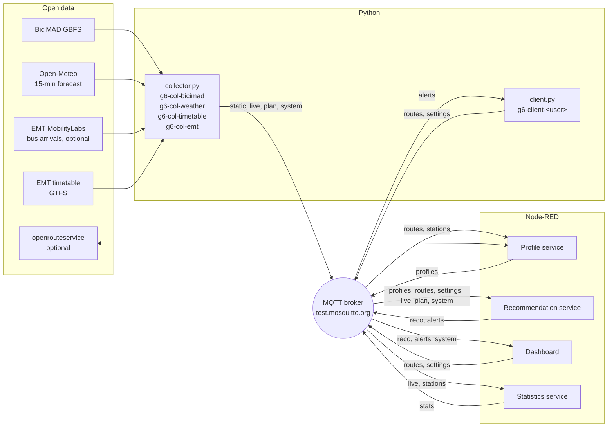

# MadridMove – Can I make my BiciMAD trip as planned?

Regular BiciMAD riders save their trip once: **start and destination station, departure time, weekdays**. Before every trip the system gets in touch by itself:

- **30 min before departure** the recommendation starts; **15 min before** a short check: "✓ Bike is fine: 7 bikes at Sol, dry, 14 °C, approx. 22 min"
- a **warning** if something speaks against the bike: rain, wind or temperature during the trip beyond the **personal limit**, no bikes at the start station or nearby, or walking/transit is at least 5 min faster. With alternatives.
- an **all-clear** as soon as the bike is fine again.

The BiciMAD app only shows how many bikes are where right now. MadridMove assesses *your* trip at the *right* time and stays quiet as long as everything is fine.

Course project Distributed Systems for IoT (UPM), group 6: Tobias Kleinkauf, Gabriel Ninos. Built with **MQTT**, **Python** (producers and consumers) and **Node-RED** (processing and dashboard).

---

## Architecture



**Python at the edges, Node-RED in the middle, MQTT connects everything.** No service knows another one directly: each one only publishes and subscribes to topics.

| Part | Language | Task |
|---|---|---|
| `python/collector.py` | Python | **Producer**: stations, bikes (changes only), weather with forecast, bus timetable, bus arrivals (EMT, optional) |
| `python/emt.py` | Python | Login at EMT MobilityLabs, token cache and automatic renewal |
| `python/gtfs_plan.py` | Python | EMT bus timetable (GTFS): best direct bus connection per route |
| `python/client.py` | Python | **Producer + consumer**: save routes and settings, receive notifications |
| Profile service | Node-RED | Route → bike time, walking time, transit estimate (openrouteservice if a key is set) |
| Recommendation service | Node-RED | "planned" (preview) before the time window; inside it bike ok or warning, plus notifications |
| Statistics service | Node-RED | Key figures for the charts: fill level over 24 h, centre vs outskirts, weather and bike use |
| Dashboard | Node-RED | Route overview (recommendations), Statistics (charts), Manage routes (forms), System status, demo |

## Topics (prefix `upm-dsiot-g6/move`)

| Topic | Content | QoS | Retained | Publisher |
|---|---|---|---|---|
| `static/stations` | station list (id, name, lat, lon, capacity) | 1 | yes | Collector |
| `live/bicimad/<station>` | `{bikes, docks, renting, returning, ts}`, only on change, at the latest every 10 min | 0 | yes | Collector |
| `live/weather` | current weather + 24 h forecast in 15-min steps | 0 | yes | Collector |
| `live/emt/<user>/<route>` | `{stop:{id,name,distM}, arrivals:[{line,destination,min}], ts}` next buses near the start, every 90 s | 0 | yes | Collector (only with EMT access) |
| `plan/<user>/<route>` | best direct bus connection by timetable for the next departure: line, boarding/alighting stop, departure or headway, ride time, total time; `status` ok / nodirect / noservice | 1 | yes | Collector |
| `stats/now` | free bikes, empty/full stations, fill level centre/outskirts | 0 | yes | Statistics service |
| `stats/spatial` | per station `[km to Sol, fill level %]` | 0 | yes | Statistics service |
| `stats/history` | history: fill level (5 min, 24 h), bike movements + weather (10 min, 24 h) | 1 | yes | Statistics service |
| `routes/<user>/<route>` | `{name, from:{id,label}, to:{id,label}, departure:{time, days}}`, empty = delete | 1 | yes | Client / Dashboard |
| `users/<user>/settings` | `{rain: none/light/any, windMax, tempMin, tempMax}` | 1 | yes | Client / Dashboard |
| `profiles/<user>/<route>` | bike time, elevation, walking time, transit estimate | 1 | yes | Profile service |
| `reco/<user>/<route>` | status planned / ok / warn / unknown with reasons and alternatives | 1 | yes | Recommendation service |
| `alerts/<user>` | pre-departure info, warning, all-clear (text) | 1 | no | Recommendation service |
| `system/<service>` | `online` / `offline (stopped)` / `offline (crashed)` | 1 | yes | Birth / close / **Last Will** |

**Last Will topics:** `system/bicimad`, `system/weather`, `system/timetable` and `system/emt` (collector, one connection each), `system/client-<user>` (client). If a connection breaks without DISCONNECT, the broker publishes "offline (crashed)" (retained). On a clean shutdown the programs first send "offline (stopped)", on start "online" (birth message).

## Delivery semantics

| Data | QoS | Semantics | Reason |
|---|---|---|---|
| Live data (bikes, weather, bus arrivals) | 0 | **at-most-once** | A lost value does not matter, the next one arrives within ≤ 1 min. Retained messages make sure new subscribers still get the latest state at once. |
| Routes, settings, profiles, timetable, status, notifications | 1 | **at-least-once** | Must not be lost. Duplicates are harmless: routes and status are simply overwritten (idempotent), a duplicate notification does no harm. |
| Notifications to the client | 1 + persistent session | **at-least-once**, even offline | The client connects with a fixed ID and `clean_session=False`. The broker keeps notifications while the client is off. |
| – | 2 | exactly-once not needed | QoS 2 costs four messages per delivery and brings nothing here, because no message causes harm when delivered twice. |

## Logic

All values are in Node-RED in the tab *⚙ Configuration* under `reco`.

| Check | Rule |
|---|---|
| Time window | Recommendation only 30 min before departure (`windowMin`). Before that the route is **"planned"**: bike time, weather preview (once the departure is within the 24 h forecast), bus comparison and "recommendation from HH:MM", but no verdict and no bike count, because bike availability is only meaningful short-term. If the forecast would break a limit, this appears as a preview on the card, without a notification. |
| Weather | Forecast for the trip (departure to arrival). Warning if the personal limit is exceeded: rain ("no rain": from 0.1 mm/15 min, "light rain ok": from 1.0 mm), wind above `windMax`, temperature outside `tempMin`–`tempMax`. |
| Bikes | 3 or more bikes: ok. Fewer: an alternative station within 500 m with ≥ 3 bikes → hint only. None → warning. |
| Alternatives | Walking or transit at least 5 min faster → warning. Every warning lists both alternatives. |
| Transit | 1. **Timetable** (EMT GTFS): best direct bus line from a stop within 600 m of the start to a stop within 600 m of the destination, at the planned departure. Time = walk + wait (half the headway for frequency-based lines) + ride time by timetable + walk. If no direct bus runs at that time (wait > 60 min), transit is not an alternative. 2. **EMT live** (departure in ≤ 20 min): if the timetable line is currently on its way to the stop, the real waiting time replaces the planned one. 3. **Estimate** if there is no direct line (maybe possible with a transfer): walking + 4 min wait + distance at 18 km/h. |
| Full destination station | not an issue, the bike can be left next to it |
| Default limits | cautious: no rain, wind up to 25 km/h, 8–30 °C |
| Notifications | only inside the time window: warning on a change to "warn" (also on entering the window), pre-departure info 15 min before, all-clear only after a warning |
| Missing data | if station or weather data are missing inside the window, the status is "unknown" and there is no notification (otherwise, e.g., a collector crash would cause a false all-clear) |

---

## Setup and start

Requirements: Node-RED with `@flowfuse/node-red-dashboard` (menu → Manage palette), Python 3.9+. On Windows Python is called `py`, on macOS/Linux `python3`.

```bash
# 1. Once (in the repository root)
python3 -m venv .venv && source .venv/bin/activate
pip install -r python/requirements.txt
python3 configure.py 6            # development: own prefix with python3 configure.py 6 <name>; before committing: python3 configure.py 6

# 2. Node-RED (terminal 1), optionally with an openrouteservice key for real bike/walking times
read -s "ORS_API_KEY?ORS key: "; export ORS_API_KEY; node-red      # zsh; without a key just: node-red
#    http://localhost:1880 -> menu -> Import -> flows/madridmove.json -> "Replace" on conflicts -> Deploy

# 3. Collector (terminal 2, keeps running)
cd python && python3 collector.py

# 4. Client (terminal 3)
cd python && python3 client.py listen gabriel
```

Dashboard: http://localhost:1880/dashboard. If the network blocks port 1883, use the phone hotspot.

### Timetable (automatic)

On start the collector downloads the EMT bus timetable (GTFS, about 236 lines) to `python/gtfs/transitemt.zip` and renews it weekly; no account is needed. If the download fails (firewall, port 8443), download the file in a browser from https://servicios.emtmadrid.es:8443/gtfs/transitemt.zip and put it there. Test without MQTT: `python3 gtfs_plan.py test 40.4169 -3.7035 40.4437 -3.7276 08:30` (start, destination, time).

### EMT bus arrivals (optional)

1. Copy `python/secrets.env.example` and name the copy `python/secrets.env`.
2. Fill in `EMT_EMAIL=` and `EMT_PASSWORD=` (account from mobilitylabs.emtmadrid.es). Alternatively `EMT_CLIENT_ID=` and `EMT_PASSKEY=`.
3. Test: `cd python` and `python3 emt.py test` → "OK: token available, valid for 24.0 h".
4. Restart `python3 collector.py` → log shows "EMT: logged in …", the dashboard shows "EMT bus" in green.

`secrets.env` and the token cache `.emt_token.json` are listed in `.gitignore` and never end up in the repo. The password stays on the machine running the collector; only bus arrivals go over MQTT. The token (valid about 24 h) is renewed automatically 30 min before it expires and when it is rejected (code 80). Without `secrets.env` everything runs with the timetable only.

### Client

```bash
python3 client.py stations sol                                   # find station numbers
python3 client.py add-route gabriel "To university" --from 1 --to 6 --time 08:30 --days 1-5
python3 client.py settings gabriel --rain light --wind 35 --temp 5 32
python3 client.py routes gabriel                                 # routes + current status
python3 client.py listen gabriel                                 # notifications (persistent session)
python3 client.py delete-route gabriel to-university
```

## Demo (about 4 min, real data only)

Screen: on the left the dashboard (*Route overview*), on the right a terminal with `python3 client.py listen demo` and next to it a subscriber showing the raw messages (`mosquitto_sub` or MQTT Explorer). The dashboard has no pop-ups: it shows the state, the notifications go to the client.

1. **Add a route**: on *Manage routes*, as user `demo`, add a route with departure in about 12 min (or on *System & demo* "Create demo route": Sol → Ciudad Universitaria, departure in 14 min, default limits). The subscriber shows `routes/demo/…`, the card appears, the client reports "saved … ✓ Bike is fine" and shortly afterwards the pre-departure info.
2. **Personal limits with real weather**: under *My settings* set the minimum temperature above the current temperature → **warning** with alternatives (bus by timetable, walking). Set it back → **all-clear**.
3. **Last Will**: close the collector window hard (or `kill -9`) → after about 45 s "offline (crashed)", a hint appears on *Statistics* and *System & demo*; the route card switches to "? Data missing" without a false all-clear.
4. Optional **persistent session**: stop the client, change a setting, restart the client → "(session resumed)", the missed notification is delivered.

## Dashboard charts (page *Statistics*)

| Chart | What it shows | Data |
|---|---|---|
| Madrid now | weather, free bikes, empty/full stations, fill level, bike movements, status of the data sources (BiciMAD, weather, timetable, EMT) | `stats/now`, `live/weather`, `system/+` |
| Bike distribution: fill level (last 24 h) | fill level (bikes ÷ docks) in the centre (≤ 3 km around Sol) and in the outskirts over 24 h | one point every 5 min |
| Bike distribution: centre vs outskirts (now) | every station: distance to Puerta del Sol vs fill level | every minute |
| Bike use and weather (last 24 h) | three charts on the same time axis: bike movements per 10 min, rain (mm), temperature and wind | every 10 min, 24 h |

The history is retained on `stats/history` and taken over after a Node-RED restart. The charts only fill while the collector and Node-RED are running: for the presentation, start them a few hours before.

## Tests (for the report)

| # | Test | Expected |
|---|---|---|
| 1 | Reload the dashboard | filled at once (retained) |
| 2 | Add a route with departure in 16 min | pre-departure info after about 1 min |
| 3 | Route with departure in 2 h, minimum temperature above the current temperature | card stays "planned" with the preview "forecast: …", **no** notification; the warning comes 30 min before departure |
| 4 | Stop the collector with Ctrl+C | `system/bicimad` = "offline (stopped)" |
| 5 | Kill the collector (`kill -9 <PID>`) | "offline (crashed)" (Last Will) |
| 6 | Stop the client, change a setting (trigger a warning), restart the client | "session resumed", missed notifications are delivered |
| 7 | Two users with the same route, only one with a tight temperature limit | warning only for that user |
| 8 | Stop the collector and wait 15 min | status "? Data missing", no notification |

Watch everything: `mosquitto_sub -h test.mosquitto.org -t 'upm-dsiot-g6/move/#' -v`

## Limitations and future work

- Transit: only direct bus connections by timetable, no transfers, no Metro/Cercanías. Without a direct line the estimate is used. Next step: routing with transfers (e.g. Transitous) and the GTFS timetables of Metro and Cercanías.
- Public broker without authentication or encryption: anyone can read along and change routes. In production: own broker with TLS and per-user access rights (ACLs).
- User = short name, no accounts. The dashboard is a shared overview; the personal channel is the client.
- Weather for one point (Sol), not along the route.

## Folder structure

```
flows/      madridmove.json (all 5 tabs: Configuration, Profile service, Recommendation, Dashboard, Statistics)
python/     collector.py, client.py, emt.py, gtfs_plan.py, config.py, requirements.txt, secrets.env.example
            (secrets.env, .emt_token.json and gtfs/: local only, git-ignored)
report/     architecture diagram
configure.py
```

## Saving flow changes to the repo

All tabs are in **one** file. After changes in Node-RED: menu → *Export* → *All flows* → download and overwrite `flows/madridmove.json`, then commit. Because everything is in one file, only one person should work on the flows at a time (`git pull` first, commit and push right after), otherwise there will be merge conflicts.

## Data sources and licences

- BiciMAD GBFS (EMT Madrid / Ayuntamiento de Madrid, datos.gob.es)
- Open-Meteo, CC BY 4.0
- openrouteservice (HeiGIT), map data © OpenStreetMap contributors (ODbL)
- EMT Madrid MobilityLabs (bus arrivals, account required)
- EMT GTFS (bus timetable), EMT open data portal / datos.madrid.es
